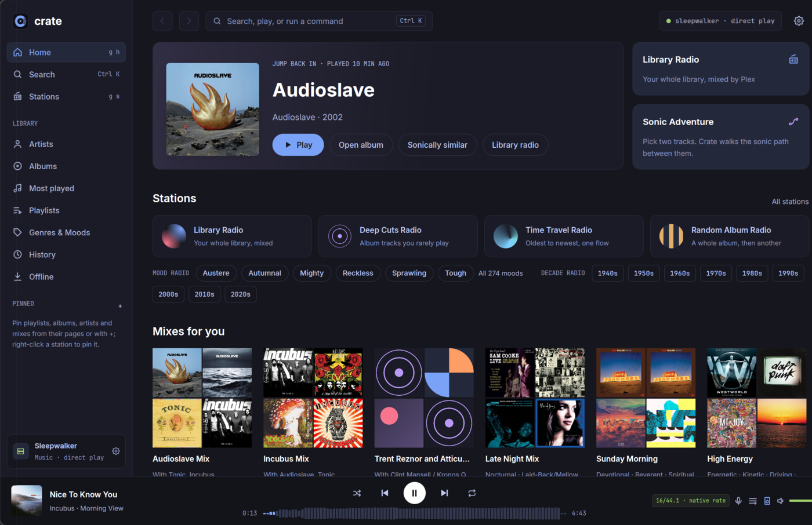
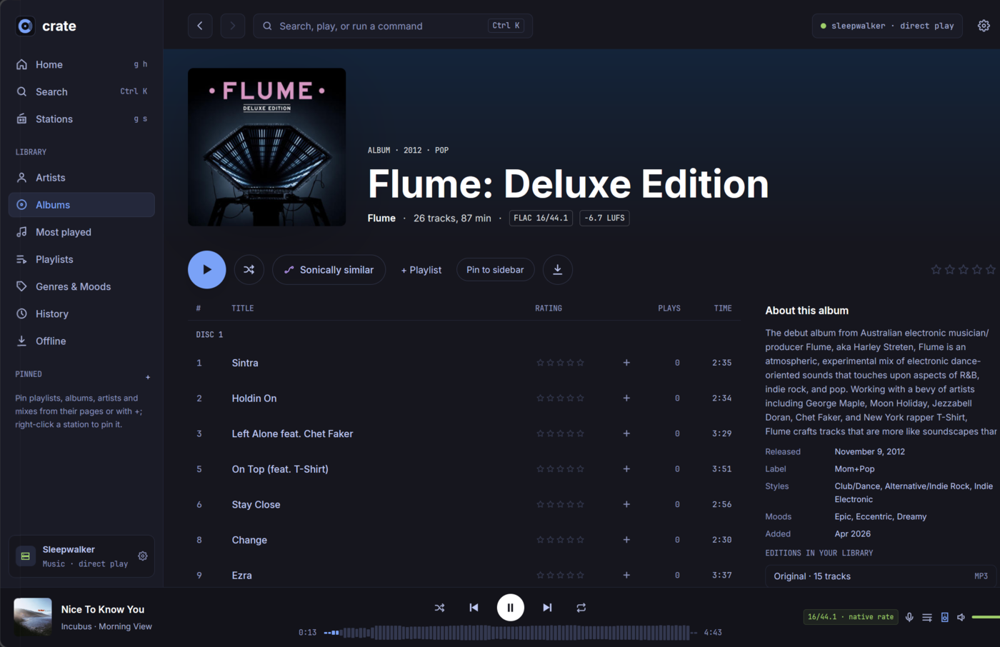
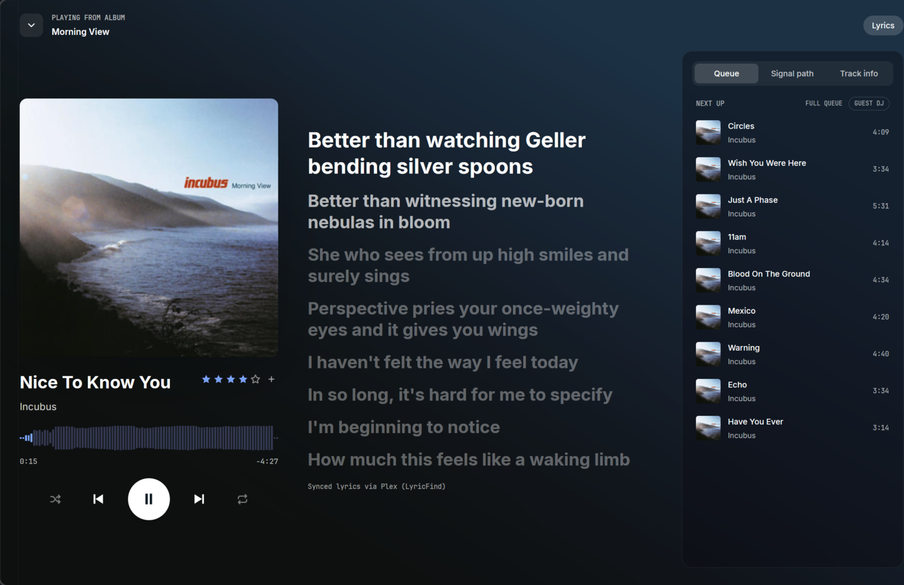
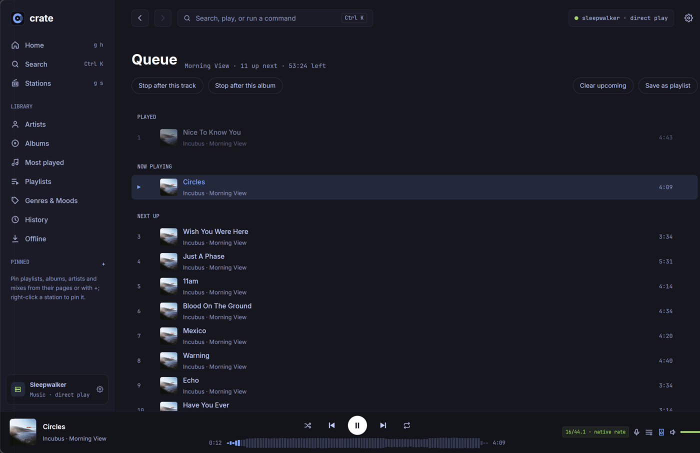

# Crate

A Plex music player for the Linux desktop, built for [Omarchy](https://omarchy.org)
(Arch + Hyprland) and at home on any Wayland or X11 desktop with PipeWire.

Crate plays your own Plex music library with a native GPU-rendered interface,
gapless and bit-perfect playback through PipeWire, and the parts of Plex that
make a big library fun: radio, sonic similarity, mixes, lyrics and history.



## Features

- **Playback that respects the music**: gapless across FLAC, ALAC, MP3, AAC
  (MP4 edit lists) and Opus; bit-perfect when PipeWire is allowed to follow the
  file's sample rate (the Signal path panel shows exactly what happens to the
  samples); optional loudness leveling (track / album / smart), crossfades
  between albums, a ten-band EQ with AutoEQ headphone presets.
- **Your library, browsable**: albums (grid or list, sort, filter by genre,
  mood, decade or rating), artists, album pages with disc headers and editions,
  playlists you can create, rename, reorder and delete, history, most played.
- **Discovery**: Plex stations and mood/decade radio, artist mixes, "sonically
  similar" albums and artists, Sonic Adventure (a path between two tracks), a
  Guest DJ that slips in sonically close tracks.
- **Now Playing**: synced lyrics (when Plex has them), a queue page with
  reorder, remove, clear and "stop after this track / album", live
  visualizers on the track bar.
- **Away from home**: streams originals on your LAN or tailnet; elsewhere,
  Plex transcodes to Opus at a quality you pick, still gapless. Seeks start
  the transcode at the seek point.
- **Offline**: keep albums on disk; they play even when the server can't be
  reached.
- **Desktop citizen**: MPRIS (media keys, the Omarchy bar), follows your
  Omarchy theme if you like, a command palette (Ctrl K), resumes where you
  left off, pins in the sidebar.

| Album | Now Playing | Queue |
|---|---|---|
|  |  |  |

## Install

Requirements: a 64-bit Linux desktop (x86_64 or aarch64; Wayland or X11)
with glibc 2.39 or newer (Arch, Fedora 40+, Ubuntu 24.04+, Debian 13+) and **PipeWire**, the
**Opus** and **xkbcommon** libraries (`pipewire opus libxkbcommon-x11` on Arch,
`libpipewire-0.3-0 libopus0 libxkbcommon-x11-0` on Debian/Ubuntu), a GPU with
Vulkan, and a Plex Media Server with a music library. Plex Pass unlocks sonic analysis, which the
"sonically similar" features use.

### One line

```sh
curl -fsSL https://raw.githubusercontent.com/gig3m/crate/main/install.sh | sh
```

This downloads the latest release for your machine (x86_64 or aarch64) into
`~/.local` (no root), adds Crate to your app launcher, and installs the command `crate-player`. Run it again to update;
`… | sh -s -- --uninstall` removes it (your settings stay in `~/.config/crate`).

### From source

You need a recent Rust toolchain and the development headers for PipeWire,
Opus, xkbcommon, Wayland, X11 and libclang (`pipewire opus libxkbcommon-x11 libxcb
wayland clang pkgconf` on Arch; on Ubuntu 24.04 see the package list in
`.github/workflows/ci.yml`). PipeWire 0.3.49 or newer is required.

```sh
git clone https://github.com/gig3m/crate && cd crate
cargo build --release
packaging/install.sh            # or: packaging/install.sh --uninstall
```

## First run

Crate opens a sign-in screen: **Sign in with Plex** shows a code you approve in
your browser, then you pick a server and a music library. (You can also enter a
server address and token by hand.) The sign-in is saved to
`~/.config/crate/account.toml` (readable only by you).

Crate talks only to plex.tv (to sign in and find your servers) and to your own
Plex server. Plays, ratings and playlist changes are written to your server like
any Plex player's, so they show up in other Plex apps (and Last.fm, if your
server scrobbles).

## Keys

| Key | Action |
|---|---|
| Space | Play / pause |
| N / P | Next / previous |
| ← / → | Seek back / forward |
| F | Now Playing |
| L | Lyrics |
| Q | Queue |
| = / - | Volume up / down |
| 1–5 | Rate the playing track |
| Ctrl K | Command palette and search |
| G H / G S | Home / Stations |
| J / K, Enter, X | Move, open, mark (album grid and album pages) |
| R | Radio from the marked albums |
| Esc | Back |

## Settings

Most settings are in the app (Settings, from the gear). They're stored in
`~/.config/crate/config.toml`; one has no switch in the app:

```toml
# Keep the streamed-track cache somewhere else (default ~/.cache/crate/audio).
audio_cache = "/path/to/a/fast/drive"
```

Bit-perfect playback needs PipeWire to be allowed to change sample rate.
Settings → Signal shows whether it is, and copies a ready-made setup prompt for
your coding agent if it isn't.

## Building on it

`cargo clippy --all-targets` and `cargo test` are the checks. The audio engine
lives in `src/audio` (a library crate, `crate_audio`); the UI is
[GPUI](https://www.gpui.rs) with [gpui-component](https://github.com/longbridge/gpui-component);
decoding is [Symphonia](https://github.com/pdeljanov/Symphonia) plus libopus.

## License

Apache-2.0. See [LICENSE](LICENSE). The bundled Inter font is under the SIL Open
Font License (`assets/fonts/LICENSE.txt`). Crate isn't affiliated with Plex.
